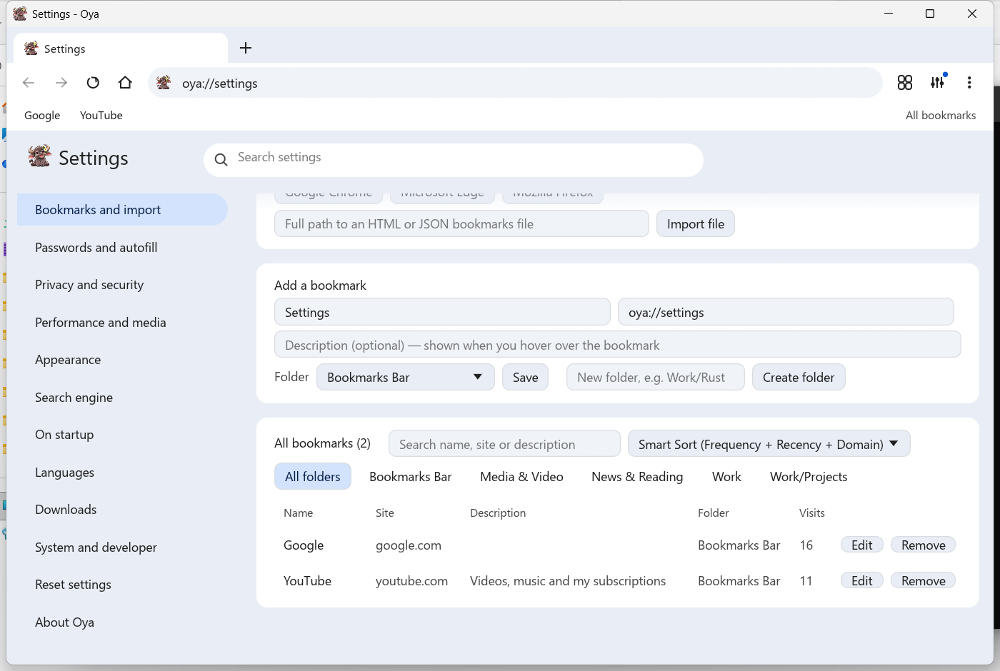
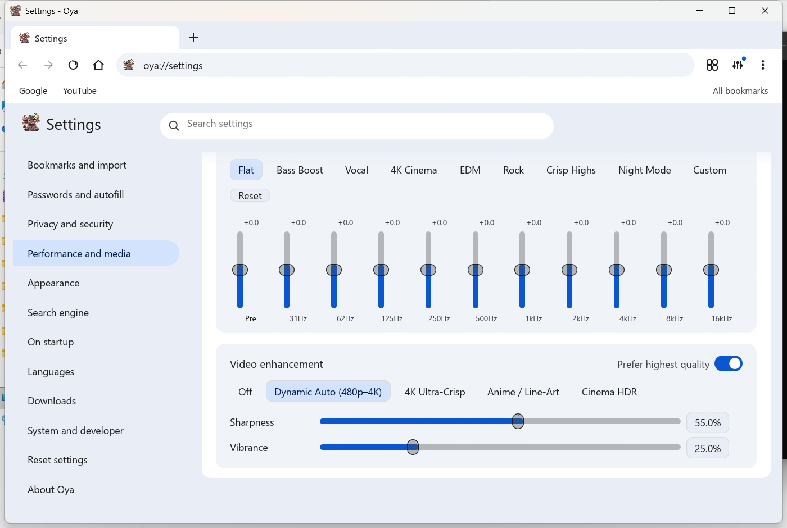
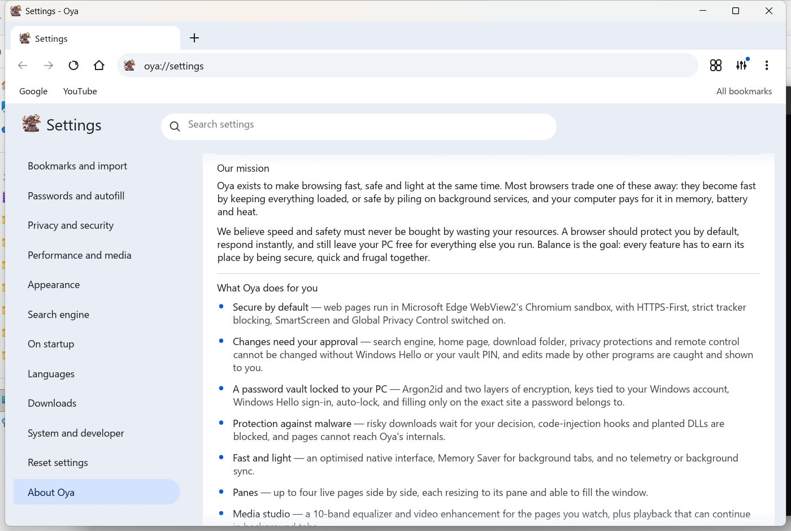

<p align="center">
  
</p>

<h1 align="center">Oya Browser</h1>

<p align="center">
  <strong>Fast, safe and light — at the same time.</strong><br>
  A free, open-source web browser for Windows with a security-first shell written in Rust.
</p>

<p align="center">
  <a href="../../releases/latest">Download</a> ·
  <a href="#features">Features</a> ·
  <a href="#security-model">Security</a> ·
  <a href="#building-from-source">Build</a> ·
  <a href="OyaBrowser.md">Technical documentation</a>
</p>

---

## Why Oya?

Most browsers trade one thing away. They become fast by keeping everything loaded, or safe by
piling on background services — and your computer pays for it in memory, battery and heat.

Oya's mission is to make browsing **fast, safe and light at the same time**. Speed and safety
should never be bought by wasting your resources: a browser should protect you by default,
respond instantly, and still leave your PC free for everything else you run. **Balance is the
goal** — every feature has to earn its place by being secure, quick and frugal together.

Oya is **free** and always will be: no accounts, no ads, no telemetry, no background sync.

## Screenshots

| Settings and bookmarks | Media studio | About |
| :---: | :---: | :---: |
|  |  |  |

## Features

**Secure by default**
- Web pages run in Microsoft Edge WebView2's Chromium multi-process sandbox.
- HTTPS-First upgrades insecure `http://` links; a red **Not secure** chip warns when a page is not encrypted.
- Strict tracker and third-party cookie blocking, Microsoft SmartScreen and the Global Privacy Control signal are on out of the box.
- Only web addresses can open: `file:`, `javascript:`, `data:` and links that launch other programs are blocked, and pop-ups open as normal tabs.

**Nothing changes without your approval**
- Changing the search engine, home or startup page, download folder or any privacy protection needs Windows Hello or your vault PIN.
- Settings and bookmarks are sealed: if another program edits them while Oya is closed, Oya keeps your version and shows you what changed.
- Remote debugging (`--remote-debugging-port`) asks first and shows a red "Remote control is on" bar while active.

**A password vault locked to your PC**
- Argon2id key derivation with two layers of encryption (AES-256-GCM inside XChaCha20-Poly1305).
- Keys are bound to your Windows account with DPAPI, so a copied vault file is useless elsewhere — even with the PIN.
- Confirm sign-ins with Windows Hello, your PIN, or (optionally) a passkey on your phone or a USB/NFC security key; passwords fill only on the exact site they were saved for.
- Auto-lock after idle time, when Windows locks, or when the PC sleeps. Strong-PIN rules with a strength meter.

**Protection against malware and spyware**
- Risky downloads (`.exe`, `.msi`, `.ps1`, `.bat`, `.js`, `.lnk`, disk images…) wait for you to click **Keep**.
- Legacy code-injection hooks are blocked; DLLs load only from System32; planted DLLs next to Oya are reported.
- Web pages cannot see or call any of Oya's internal functions.
- Full-screen requests need a real click or key press and always show "*site* is full screen — press Esc to exit".

**Fast, light and calm**
- Native Rust interface (egui) with readable light and dark themes that meet WCAG AA contrast.
- Memory Saver puts background tabs in low-memory mode and unloads long-hidden ones.
- **Panes:** up to four live pages side by side, each resizing to its pane and able to fill the window.
- **Media studio:** a 10-band equalizer and video enhancement, plus playback that can continue in background tabs.
- Chrome-style tab strip, address bar with site-security chip, a â‹® menu that floats above the page, and Settings as its own searchable tab.

## Download and install

1. Go to the [latest release](../../releases/latest) and download `OyaBrowser-vX.Y.Z-windows-x64.zip`.
2. *(Recommended)* Check the download against `SHA256SUMS.txt` from the same release:
   ```powershell
   Get-FileHash .\OyaBrowser-vX.Y.Z-windows-x64.zip -Algorithm SHA256
   ```
3. Unzip it to a folder only you can write to (for example `%LOCALAPPDATA%\Programs\OyaBrowser`) and run `oya_browser.exe`.

**Requirements:** Windows 10 or 11 (64-bit) and the Microsoft Edge WebView2 Runtime, which is
already installed on Windows 11 and up-to-date Windows 10.

> **Windows SmartScreen:** Oya's releases are not yet code-signed, so Windows may show
> "Windows protected your PC" the first time. Verify the checksum above, then choose
> **More info → Run anyway**.

Oya keeps its data in `%LOCALAPPDATA%\OyaBrowser` (settings, bookmarks, sign-ins) and
`%APPDATA%\OyaBrowser` (password vault). To uninstall, delete the program folder and those two
folders.

## Security model

| Layer | What protects it |
| --- | --- |
| Web content | WebView2 / Chromium sandbox, SmartScreen, strict tracking prevention, HTTPS-First |
| Page ↔ browser | Page identity is taken from WebView2, never from page messages; no page-visible hooks |
| Your settings | DPAPI-keyed HMAC seal; protected changes need Windows Hello or the vault PIN |
| Your passwords | Argon2id + dual AEAD, DPAPI-bound keys, auto-lock, exact-origin filling |
| Oya's process | Process mitigation policies (no injection points, System32-only DLLs, no remote images) |
| Built-in pages | Separate Oya renderer process in a Windows Job Object with mitigation policies |

Honest limits: no browser can fully defend against malware already running under your own
Windows account; Oya aims to keep attackers out, stop silent changes, and limit what a
compromise exposes. Passkeys are stored by the vault but not yet offered to websites.

Found a vulnerability? Please read [SECURITY.md](SECURITY.md) and report it privately.

## How it is built

Oya is a Rust workspace of eleven crates. Websites are rendered by **Microsoft Edge WebView2**
(Chromium); everything around them — the window, tabs, settings, vault, security checks — is Rust.
A small Rust engine (html5ever, Taffy, Boa) renders Oya's own `oya://` pages and the headless mode.

| Crate | Purpose |
| --- | --- |
| `rc_browser` | The application: egui window, tabs, panes, settings, WebView2 integration |
| `rc_vault` | Password and passkey vault (Argon2id, AES-256-GCM, XChaCha20-Poly1305, P-256) |
| `rc_sandbox` | Windows hardening: Job Objects, mitigation policies, DPAPI, ACL and override checks |
| `rc_cdp` | Token-protected Chrome DevTools Protocol server for automation |
| `rc_net` | Rust networking (ureq + rustls) for built-in pages |
| `rc_dom`, `rc_layout`, `rc_js` | HTML parsing, layout and JavaScript for `oya://` pages |
| `rc_renderer`, `rc_ipc` | Isolated renderer process and its message protocol |
| `rc_log` | Diagnostics and crash logging (no browsing history) |

Most crates use `#![forbid(unsafe_code)]`; Windows API calls are confined to `rc_sandbox` and the
WebView2 integration. See [OyaBrowser.md](OyaBrowser.md) for the full technical documentation.

## Building from source

Requirements: Windows 10/11 x64, [Rust](https://rustup.rs) (stable, edition 2024), and the
Visual Studio C++ Build Tools with the Windows SDK.

```powershell
git clone https://github.com/Jatwaa/oya-browser.git
cd oya-browser
cargo test --workspace                 # run the test suite
cargo run -p rc_browser                # start Oya (debug build)
cargo build --release -p rc_browser    # optimised build: target\release\oya_browser.exe
.\generate_distrib.ps1                 # package Distrib\vX.Y.Z\OyaBrowser-vX.Y.Z-windows-x64.zip
```

Useful command-line options:

```powershell
oya_browser.exe https://example.com                         # open a page
oya_browser.exe --headless --dump-dom oya://newtab           # print the DOM of a built-in page
oya_browser.exe --remote-debugging-port=9222                 # DevTools Protocol (asks for approval)
```

## Releases

Releases are built by GitHub Actions from tagged commits (`v1.1.0`, …) on a clean Windows runner:
the workflow runs the tests, builds the optimised binary, packages it with
`generate_distrib.ps1`, and attaches the ZIP and `SHA256SUMS.txt` to the GitHub release.

## Contributing

Bug reports, ideas and pull requests are welcome — see [CONTRIBUTING.md](CONTRIBUTING.md).
Please keep the project's balance in mind: changes should be secure, fast and light together.

## License

Oya Browser is free software, dual-licensed under either of

- [MIT License](LICENSE-MIT)
- [Apache License, Version 2.0](LICENSE-APACHE)

at your option.
